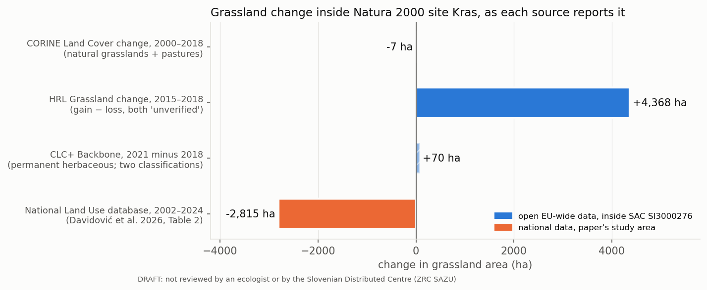

# Natura 2000 site evidence — Kras (SI3000276)

```{warning}
**Draft study.** Not yet reviewed by an ecologist or by the Slovenian Distributed Centre of LifeWatch
(ZRC SAZU). Nothing has been deposited or published as a nanopublication. Results from the Slovenian
Land Use database (MKGP) are not shown on this site until MKGP gives permission.
```

**Aim.** Give Slovenia up-to-date, site-level information to act on in its Natura 2000 sites: per site,
how much permanent grassland, overgrown agricultural land, trees and shrubs and forest there is now,
how that changed since the last update and since 2002, where, and how current the mapping is. Pilot:
SAC **SI3000276 Kras** (48,042 ha, Continental region), whose qualifying habitats include 62A0, Eastern
sub-Mediterranean dry grasslands (10,110 ha in the Standard Data Form).

| Layer | Data | On this site |
|---|---|---|
| [Service](service/service.md) (core) | Slovenian Land Use database (MKGP "RABA"), monthly snapshots | what is monitored and how to run it; **no results** pending MKGP permission |
| [Validation](validation.md) | Davidović, Čuš & Ivajnšič 2026, [doi:10.3986/AGS.14021](https://doi.org/10.3986/AGS.14021) | the claims under test and the boundary question |
| [EU comparison](notebooks/03_analysis.ipynb) | Article 17, CORINE, CLC+ Backbone, HRL Grassland | results |
| [Species](notebooks/02_data_clean.ipynb) (supporting) | GBIF [doi:10.15468/dl.5epzsz](https://doi.org/10.15468/dl.5epzsz) on HEALPix (GRID4EARTH DGGS-Zarr) | results |



**So far:** open EU-wide data cannot tell whether grassland (and habitat 62A0) is declining inside the
site. CORINE's change layers find 7.4 ha lost from grassland classes in 2000–2018; the national data,
as analysed by Davidović et al. (2026), show grasslands −26.9 % and overgrown areas +47.3 % in
2002–2024 for the Natura 2000 part of the Kras plateau.

## How to comment or correct

Please tell us what is wrong or missing. Corrections are credited by name (and ORCID if you give one).

- [Scientific review form](https://github.com/annefou/natura2000-kras-site-evidence/issues/new?template=scientific-review.yml): a claim, figure or step.
- [Data or site correction form](https://github.com/annefou/natura2000-kras-site-evidence/issues/new?template=data-correction.yml): Standard Data Form, Article 17 code labels, boundaries, national data that could fill a gap.

Expert input is especially wanted on: the 62A0 trend statement; the official labels of the Article 17
pressure codes beyond PA05; whether CORINE natural grasslands + pastures is a fair proxy for 62A0 on
Kras; national datasets that could replace the 2004 bat records (and fill gaps such as *Proteus
anguinus*); and the study-area polygon of Davidović et al. 2026.

Source code: <https://github.com/annefou/natura2000-kras-site-evidence> · Draft story page: [blog/](https://annefou.github.io/natura2000-kras-site-evidence/blog/)
